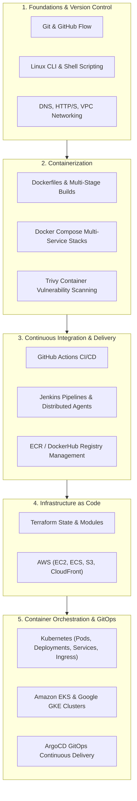

# Complete DevOps Training Resources & Interview Roadmap

<div align="center">

[](https://github.com/codewithmuh/devops-training-resources/releases)
[](https://opensource.org/licenses/MIT)
[](https://github.com/codewithmuh/devops-training-resources/stargazers)
[](https://github.com/codewithmuh/devops-training-resources/network/members)
[](https://github.com/codewithmuh/devops-training-resources)
[](https://www.docker.com/)
[](https://www.terraform.io/)
[](https://www.youtube.com/@codewithmuh)

**A curated, practical master guide for mastering modern DevOps: Git workflows, Docker containerization, Terraform Infrastructure as Code, Kubernetes orchestration, CI/CD pipelines, and interview preparation.**

[DevOps Roadmap](#devops-engineering-learning-roadmap) • [Git & GitHub](#1-git--github-mastery) • [Docker & Containers](#2-docker--container-virtualization) • [Terraform IaC](#3-infrastructure-as-code-with-terraform) • [Kubernetes Orchestration](#4-kubernetes-container-orchestration) • [Resume & Careers](#5-devops-resume-linkedin--interview-prep)

</div>

---

## Overview

Welcome to the **DevOps Training Resources Hub** created by [@codewithmuh](https://www.youtube.com/@codewithmuh). This repository brings together high-yield slides, real-world cloud deployment projects, hands-on tutorials, interview cheat sheets, and battle-tested industry configurations.

📊 **Comprehensive Course Slides:**
- [DevOps Master Course Slides (Canva Deck)](https://www.canva.com/design/DAGGclQdaHc/TsFDqS09EJNsNv0kGjvmkA/view?utm_content=DAGGclQdaHc&utm_campaign=designshare&utm_medium=link&utm_source=editor)
- [Kubernetes Deep Dive Slides (Canva Deck)](https://www.canva.com/design/DAGMoIADQZA/PiRUFyPyf9wqbET66GdnKg/view?utm_content=DAGMoIADQZA&utm_campaign=designshare&utm_medium=link&utm_source=editor)

---

## DevOps Engineering Learning Roadmap



---

## 1. Git & GitHub Mastery

Master collaborative version control, merge strategies, and automated deployment pipelines:

| Topic | Type | Link |
|---|:---:|---|
| **Git Repository Best Practices for Developers** | Article | [Read on LinkedIn](https://www.linkedin.com/pulse/git-repository-best-practices-developers-muhammad-rashid-4le1f/) |
| **How to Clone & Authenticate Private Repositories** | Video & Code | [YouTube Video](https://youtu.be/kgrWQ2xV_Gc) • [GitHub Repo](https://github.com/codewithmuh/clone-private-repo) |
| **CI/CD Pipeline for React on AWS EC2** | Project | [GitHub Repo](https://github.com/codewithmuh/github-actions-cicd-react-aws-ec2) |
| **Automated React CI/CD with GitHub Actions** | Article | [Read on LinkedIn](https://www.linkedin.com/pulse/cicd-pipeline-nodejs-react-application-using-github-actions-rashid-d2svf/) |

---

## 2. Docker & Container Virtualization

From standard Dockerfiles to multi-stage production images and docker-compose stacks:

| Topic | Type | Link |
|---|:---:|---|
| **Complete Guide to Docker & Docker Compose** | Article | [Read on LinkedIn](https://www.linkedin.com/pulse/learn-docker-compose-muhammad-rashid-tds2f/) |
| **Dockerize a Production React Application** | Code | [GitHub Repo](https://github.com/codewithmuh/dockerize_react) |
| **Django + Celery + Redis + Postgres Starter Kit** | Code & Article | [GitHub Repo](https://github.com/codewithmuh/django-starter-kit) • [LinkedIn Article](https://www.linkedin.com/pulse/django-starter-kit-simplifying-development-docker-celery-rashid-jz6of/) |
| **GitHub Actions + Docker + AWS EC2 Automated Deployment** | Video & Code | [YouTube Video](https://youtu.be/UK_OVKDRArs) • [GitHub Repo](https://github.com/codewithmuh/github-actions-cicd-react-aws-ec2) |
| **Top 30 Docker Interview Questions & Answers** | Interview Prep | [Read on LinkedIn](https://www.linkedin.com/pulse/top-30-docker-interview-questions-muhammad-rashid-zlpsf) |

---

## 3. Infrastructure as Code with Terraform

Provision repeatable, immutable cloud infrastructure using HashiCorp Terraform and AWS:

| Topic | Type | Link |
|---|:---:|---|
| **Deploy First AWS Infrastructure using Terraform** | Article & Code | [Read Blog Guide](https://www.codewithmuh.com/blog/getting-started-with-terraform-deploying-your-first-aws-infrastructure-using-terraform) • [GitHub Repo](https://github.com/codewithmuh/terraform-training) |
| **Terraform Installation & AWS CLI Setup** | Video Tutorial | [Watch on YouTube](https://youtu.be/dA6WqakJOts) |
| **Terraform Workflow Deep Dive** | Video Tutorial | [Part 1 Video](https://youtu.be/bUmGc8Sd3Cw) • [Part 2 Video](https://youtu.be/z_b18oRekHk) |

```bash
# Standard Terraform Execution Workflow
terraform init          # Initialize provider plugins & backend
terraform validate      # Syntax and configuration validation
terraform plan -out tfplan # Preview state changes
terraform apply tfplan  # Provision infrastructure on AWS
terraform destroy       # Tear down managed resources
```

---

## 4. Kubernetes Container Orchestration

Architecting resilient distributed applications on Kubernetes, Amazon EKS, and Google GKE:

| Topic | Type | Link |
|---|:---:|---|
| **Analogy of Kubernetes (Visual Beginner's Guide)** | Guide & Visuals | [GitHub Guide](https://github.com/codewithmuh/analogy-of-kubernetes) • [LinkedIn Article](https://www.linkedin.com/pulse/analogy-kubernetes-explained-muhammad-rashid-rx6jf/) |
| **Deploy React on AWS EKS using GitHub Actions** | Project & Article | [GitHub Repo](https://github.com/codewithmuh/react-aws-eks-github-actions) • [LinkedIn Article](https://www.linkedin.com/pulse/deploy-react-applications-aws-eks-using-github-actions-rashid-hs3sf/) |
| **Kubernetes Core Concepts Canva Slide Deck** | Slides | [View Presentation](https://www.canva.com/design/DAGMoIADQZA/PiRUFyPyf9wqbET66GdnKg/view?utm_content=DAGMoIADQZA&utm_campaign=designshare&utm_medium=link&utm_source=editor) |
| **Official `kubectl` CLI Documentation** | Official Docs | [Kubernetes.io Docs](https://kubernetes.io/docs/tasks/tools/#kubectl) |

---

## 5. DevOps Resume, LinkedIn & Interview Prep

Industry-tailored resume templates and personal branding strategies for landing DevOps and Platform Engineering roles:

- 📄 **Production DevOps Resume Template 1:** [Google Docs Template](https://docs.google.com/document/d/1D5SnfrsU-Jq1Y1voeilr0Co_lY4eFT_MP5lwXcxg0T8/edit?usp=sharing)
- 📄 **Production DevOps Resume Template 2:** [Google Docs Template](https://docs.google.com/document/d/1NgchuqM84reL00nHkLrrQKI7SXI8vpNTsOnFTuKDaAI/edit?usp=sharing)
- 🌐 **Connect on LinkedIn:** [Muhammad Rashid Profile](https://www.linkedin.com/in/codewithmuh)
- 📺 **Subscribe on YouTube:** [CodeWithMuh Channel](https://www.youtube.com/@codewithmuh)

---

## License

This resource collection is open-source under the [MIT License](LICENSE).
